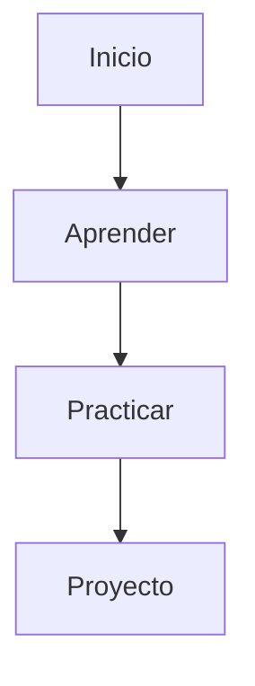

# Título H1

Descripción breve del documento.

---

## Título H2

### Título H3

#### Título H4

##### Título H5

###### Título H6

---

## Texto

Texto normal.

**Negrita**

_Itálica_

**_Negrita e itálica_**

~~Texto tachado~~

> Esto es una cita.

> También puede tener varias líneas.
>
> Como esta.

---

## Listas

### Lista no ordenada

- Elemento 1
- Elemento 2
  - Sub-elemento
  - Otro sub-elemento

### Lista ordenada

1. Primer elemento
2. Segundo elemento
3. Tercer elemento

### Lista de tareas

- [x] Aprender variables
- [x] Aprender funciones
- [ ] Aprender promesas
- [ ] Aprender TypeScript

---

## Código

### Código en línea

Utiliza `console.log()` para imprimir mensajes.

### Bloque de código JavaScript

```javascript
function greet(name) {
  return `Hola ${name}`;
}

console.log(greet("Carlos"));
```

### Bloque de código Bash

```bash
npm install
npm run dev
```

### Bloque de código JSON

```json
{
  "name": "project",
  "version": "1.0.0"
}
```

---

## Enlaces

[OpenAI](https://openai.com)

<https://github.com>

---

## Imágenes


---

## Tablas

| Nombre | Edad | Ciudad    |
| ------ | ---- | --------- |
| Juan   | 25   | Madrid    |
| Ana    | 30   | Barcelona |
| Luis   | 22   | Valencia  |

---

## Línea horizontal

---

## Bloques destacados

> [!NOTE]
> Información adicional.

> [!TIP]
> Consejo útil.

> [!IMPORTANT]
> Información importante.

> [!WARNING]
> Atención a este punto.

> [!CAUTION]
> Puede causar problemas si se ignora.

---

## Detalles desplegables

<details>
<summary>Haz clic para expandir</summary>

Contenido oculto.

- Punto 1
- Punto 2

```javascript
console.log("Hola");
```

</details>

---

## Emojis

🚀 🎯 📚 💡 🔥

---

## Diagrama Mermaid



---

## Árbol de directorios

```text
javascript/
├── fundamentals/
├── advanced/
├── examples/
└── projects/
```

---

## Referencias

### Recursos

- MDN
- JavaScript.info
- Node.js Docs

### Notas

1. Primera nota.
2. Segunda nota.

---

## Progreso

| Tema        | Estado |
| ----------- | ------ |
| Variables   | ✅     |
| Funciones   | ✅     |
| Objetos     | ✅     |
| Async/Await | ⏳     |
| TypeScript  | ❌     |

---

## Resumen

- Concepto 1
- Concepto 2
- Concepto 3

---

## Firma

Última actualización: 2026-06-23
